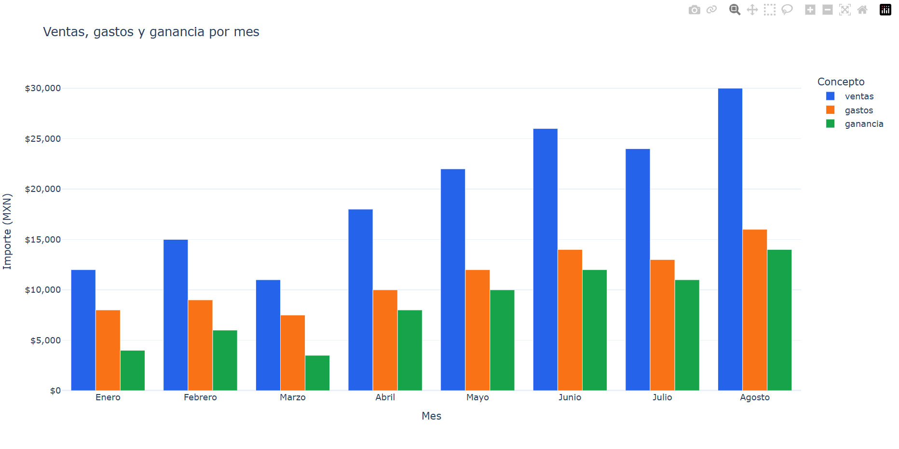

# Dashboard de ventas con Python

Análisis de ventas, gastos y ganancias mensuales con **pandas y Plotly**, desarrollado por **David Aldana**.

## Objetivo

Comparar el desempeño de ocho meses mediante un gráfico interactivo y generar reportes reutilizables en CSV y HTML.

Los datos son ejemplos definidos dentro del código y los importes están expresados en pesos mexicanos.

## Funcionalidades

- Calcula la ganancia mensual: ventas menos gastos.
- Muestra en consola los totales del periodo.
- Identifica los meses con mayor y menor ganancia.
- Genera un gráfico de barras agrupadas.
- Exporta los resultados a CSV.
- Guarda el gráfico interactivo en HTML.

## Tecnologías

- Python.
- pandas.
- Plotly Express.

## Cómo ejecutarlo

Descarga el repositorio y abre una terminal dentro de su carpeta.

Instala las dependencias:

    python -m pip install -r requirements.txt

Ejecuta el programa:

    python dashboard_ventas_plotly.py

## Archivos generados

El programa guarda estos archivos junto al script:

| Archivo | Contenido |
|---|---|
| reporte_ventas_dashboard.csv | Datos mensuales y ganancias calculadas |
| dashboard_ventas.html | Gráfico interactivo para abrir en un navegador |

## Resultados de los datos de ejemplo

| Indicador | Importe |
|---|---:|
| Ventas totales | $158,000 MXN |
| Gastos totales | $89,500 MXN |
| Ganancia total | $68,500 MXN |

## Personalización

Modifica las listas MESES, VENTAS y GASTOS del script para analizar otros valores. Las tres listas deben tener la misma cantidad de elementos.

## Autor

**David Aldana**

[Ver perfil de GitHub](https://github.com/david33-tech)
